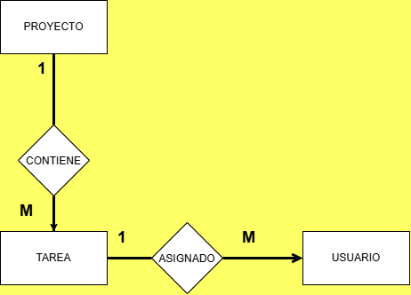
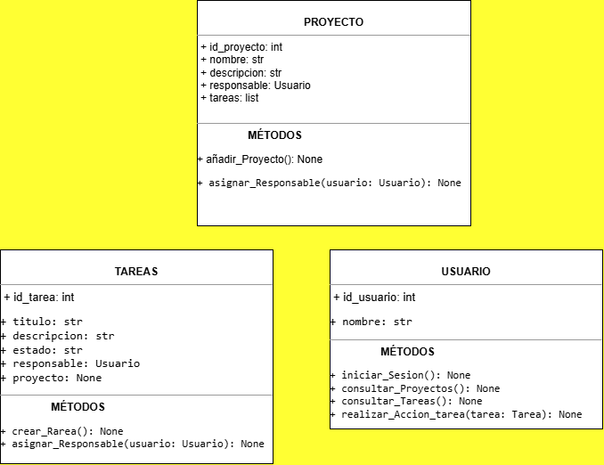

# 🧪 Laboratorio POO: Diseñar TaskFlow

## Parte 1. Analizar el problema

### Identificación de objetos

| Posible objeto | ¿Por qué existe? | ¿Qué información necesita? |
|---|---|---|
| Proyecto | Permite controlar las tareas asociadas al proyecto. | <br> - Nombre del proyecto: Permite saber cómo se llama el proyecto. <br> - Descripción: Permite explicar en qué consiste. <br> - Identificador (ID): Permite distinguirlo de otros proyectos. <br> - crqs: Permite relacionar el proyecto con el cambio que hay que realizar|
| Tarea | Representa un trabajo concreto que hay que realizar. | <br> - Nombre de tarea: Permite saber cómo se llama la tarea. <br> - Descripción tarea: Permite explicar en qué consiste. <br> - Identificador de tarea (id_tarea): Permite distinguirla de otras tareas dentro del mismo proyecto. <br> - Estado de la tarea: Los valores son pendiente, en progreso y completada. <br> - Proyecto al que pertenece la tarea. <br> - Usuario asignado |
| Usuario | Permite registrar a las personas que utilizan la aplicación. | <br> - Nombre de usuario: Permite saber cómo se llama el usuario. <br> - Identificar (id_usuario): Permite distinguir un usuario de otro. |


### Otras entidades
**¿Qué otras entidades podrían existir?**
<span style="color: #3498DB;">
    Un rol de usuario, por ejemplo, administrador o desarrollador, para diferenciar los permisos de cada usuario.
</span>

**¿Cuáles son realmente necesarias?**
<span style="color: #3498DB;">
    Proyecto, tarea y usuarios
</span>

**¿Cuáles son solamente datos o características de otras entidades?**
<span style="color: #3498DB;">
    El estado de una tarea es un atributo de Tarea, y el rol es un atributo de Usuario
</span>

> No busques todavía una única respuesta correcta. Lo importante es justificar tus decisiones.

---

## Parte 2. Identificar el estado

El estado de un objeto es la información que describe cómo se encuentra en un momento determinado.

Para cada objeto que hayas identificado, determina qué información necesita conocer.

### PROYECTO

**Estado de proyecto:**

<span style="color: #3498DB;">
    - Identificador proyecto (ID_proyecto)<br>
    - Nombre del proyecto<br>
    - Descripción<br>
    - tareas asociadas <br>
    - Responsable.<br>
</span>

### TAREA

**Estado de tarea:**

<span style="color: #3498DB;">
    - Identificador tarea (ID_tarea).<br>
    - Título.<br>
    - Descripción.<br>
    - Responsable.<br>
    - Estado.<br>
    - PROYECTO al que pertenece.<br>
</span>

### USUARIO

**Estado:**

<span style="color: #3498DB;">
    - Nombre de usuario.<br>
    - Identificador usuario (ID_usuario).<br>
</span>

<br>

> No incluyas información simplemente porque pueda resultar útil. <br>

> ¿La aplicación necesita realmente conocer ese dato para funcionar? <br>

---

## Parte 3. Identificar el comportamiento

Ahora vamos a cambiar la pregunta.

Ya no queremos saber qué tiene cada objeto. Queremos saber qué puede hacer.

### PROYECTO

**Puede realizar las siguientes acciones:**

- Crear proyecto.
- Añadir TAREAS al proyecto.
- Consultar información del proyecto.
- Modificar los datos del proyecto (mientras se encuentre en fase de borrador).

### TAREA

**Puede realizar las siguientes acciones:**
- Crear tarea.
- Asignar tarea a un grupo técnico.
- Cambiar el estado de la tarea.
- Cerrar tarea.

### USUARIO

**Puede:**

- Iniciar sesión.
- Consultar los proyectos asignados.
- Consultar las tareas asignadas.
- Realizar acciones sobre las tareas asignadas.

Piensa en comportamientos para cada objeto.

**Regla:** expresa los comportamientos como acciones.

---

## Parte 4. Responsabilidades

Ahora viene una de las decisiones más importantes de la POO.

¿Quién debería encargarse de cada acción?

Supongamos que queremos completar una tarea.

Tenemos varias posibilidades:

- Tarea.
- Usuario.
- Proyecto.
- `main.py`.

¿Quién debería ser responsable?

Justifica tu decisión.

Haz lo mismo con:

- Asignar una tarea.
- Cambiar el estado de una tarea.
- Crear un proyecto.
- Añadir una tarea a un proyecto.

Puedes utilizar esta tabla:

| Acción | Objeto responsable | ¿Por qué? |
|---|---|---|
| Completar una tarea | Tarea | Porque es el objeto que gestiona su propio estado y puede cambiarlo a completada. |
| Iniciar una tarea | Tarea | Porque es el objeto que gestiona su estado y lo cambia a EN_CURSO cuando el usuario solicita iniciarla. |
| Asignar responsable | Tarea | Porque la tarea almacena el grupo técnico responsable y permite actualizar esa información cuando un usuario realiza la asignación. |
| Crear proyecto | Proyecto | Porque es el objeto encargado de representar y almacenar la información del proyecto. |
| Añadir tarea al proyecto |  Proyecto | Porque es el objeto que contiene y gestiona la colección de tareas asociadas. |

---

## Parte 5. Diseñar el modelo

Ahora reúne tus decisiones.

Construye un primer modelo conceptual:

```text
             PROYECTO
                 |
                 | contiene
                 v
               TAREA
                 |
                 | asignada a
                 v
              USUARIO
```

## Parte 5. Diseñar el modelo



 > Añade la información y los comportamientos que hayas decidido.

---

## Parte 6. Diseñar las clases con UML

Por ejemplo:

```text
┌─────────────────────────────┐
│            Tarea            │
├─────────────────────────────┤
│ - titulo: str               │
│ - descripcion: str          │
│ - estado: str               │
│ - responsable: Usuario      │
├─────────────────────────────┤
│ + iniciar(): None           │
│ + completar(): None         │
│ + reasignar(): None         │
└─────────────────────────────┘
```



Haz lo mismo para el resto de objetos que hayas determinado.

No es necesario representar todavía las relaciones UML posibles.

---

## Parte 7. Primera implementación con Python

Ahora sí podemos programar.

Crea el proyecto utilizando el entorno profesional que hemos visto en clase.

La estructura inicial será:

```text
taskflow/
├── .gitignore
├── README.md
├── pyproject.toml
└── src/
    └── taskflow/
        └── __init__.py
```

Crea primero la clase `Tarea` y, a continuación, el resto.

Crea también el repositorio correspondiente en GitHub.

---

## Parte 8. El historial de Git

Durante el laboratorio utiliza Git para registrar la evolución del proyecto.

No esperes hasta el final.

Realiza commits cuando completes partes significativas.

Por ejemplo:

**Primer commit:**

```bash
git add .
git commit -m "chore: crear proyecto TaskFlow"
```

**Segundo commit:**

```bash
git add .
git commit -m "feat: crear clase Tarea"
```

**Tercer commit:**

```bash
git add .
git commit -m "feat: implementar comportamiento de Tarea"
```

**Subir los cambios:**

```bash
git push
```

Consulta el historial:

```bash
git log --oneline
```

Tu repositorio debe permitir observar cómo ha evolucionado el diseño.

---

## Parte 9. La IA como analista

En este laboratorio vamos a utilizar IA, pero no para que nos diseñe y programe TaskFlow.

Primero realiza tu propio análisis.

Después puedes utilizar una IA para contrastarlo.

Utiliza un prompt como este:

### Prompt de análisis

```text
Estoy diseñando una aplicación de gestión de proyectos
llamada TaskFlow.

He identificado estos objetos:

- Proyecto
- Usuario
- Tarea

Para cada uno he definido este estado:
[PEGA AQUÍ TU PROPUESTA]

Y estos comportamientos:
[PEGA AQUÍ TU PROPUESTA]

Analiza mi diseño como si fueras un analista de software.

No escribas código.

Indica:

1. Qué decisiones parecen coherentes.

#Contesta IA:
Separación en tres clases

La división entre Proyecto, Tarea y Usuario tiene sentido. Cada clase representa un elemento diferente del sistema.

Identificadores automáticos

Has utilizado contadores de clase para generar identificadores:
- PROJECT-001
- TASK-001
- USU-001
Es una decisión coherente para evitar tener que introducir los identificadores manualmente.

Relaciones entre objetos

Has establecido relaciones que tienen sentido:
- Una tarea tiene asociado un proyecto.
- Una tarea tiene asignado un usuario responsable.
- Un proyecto puede tener un usuario responsable.
Además, utilizas None cuando todavía no existe una asignación. Es una buena forma de representar esa ausencia.

Validación de datos

Me parece acertado que compruebes los campos obligatorios antes de permitir que una tarea pase a PENDIENTE.

También has contemplado pruebas negativas para comprobar qué ocurre cuando faltan datos.

Separación de comportamientos

En Tarea tienes separados:
- crear_Tarea()
- iniciar_Tarea()
- completar_Tarea()
- asignar_Responsable()
Es una buena decisión porque cada método representa una operación diferente.

2. Qué responsabilidades podrían estar mal asignadas.

#Contesta IA:
Aquí hay algunas cuestiones interesantes.

A. El inicio de sesión dentro de Usuario

Tu clase Usuario tiene el método iniciar_Sesion() y el atributo sesion_Iniciada.

Tiene sentido que el usuario gestione su propio estado de sesión.

Sin embargo, deberías preguntarte si realmente necesitas implementar un sistema de autenticación en este ejercicio.

El enunciado únicamente pide registrar usuarios. No exige expresamente inicio de sesión, contraseñas ni autenticación.

B. Las preguntas por consola dentro de las clases

Actualmente, tus métodos utilizan input() para preguntar al usuario si quiere realizar una operación.

Por ejemplo, crear_Tarea() pregunta si se quiere pasar a PENDIENTE.

Esto funciona para tu primera implementación, pero mezcla dos responsabilidades:
- La lógica de negocio de la tarea.
- La interacción con la persona que utiliza el programa.
No es necesariamente un error para este ejercicio, pero es una decisión que conviene identificar.

C. El responsable del proyecto

Has decidido que un proyecto también tenga un responsable.

Es coherente desde el punto de vista empresarial, aunque el enunciado no exige expresamente esa funcionalidad.

3. Qué información podría faltar.
#Contesta IA:
Estas son las cuestiones que más revisaría:
Información	Observación
Fecha de creación de tarea	No aparece en tu modelo.
Fecha de finalización	No aparece en tu modelo.
Estado de tarea	Sí lo tienes.
Estado de proyecto	Lo has añadido, aunque no se exige.
Responsable de tarea	Sí lo tienes.
Proyecto asociado	Sí lo tienes.
Datos de autenticación	No aparecen, pero tampoco son obligatorios según el enunciado.

No considero que debas añadir todos estos campos. Son posibilidades que debes valorar según el alcance del ejercicio.

4. Qué información podría sobrar.
#Contesta IA:
Aquí distinguiría entre lo que sobra según el enunciado y lo que puede ser útil como decisión propia.

Elementos no exigidos expresamente:
- El estado BORRADOR.
- El estado de los proyectos.
- El responsable de los proyectos.
- El inicio de sesión de los usuarios.
- La confirmación mediante preguntas S/N.
No significa que estén mal. Significa que has ampliado el modelo respecto a lo que pide el ejercicio.

Por otro lado, los identificadores automáticos y los contadores me parecen decisiones útiles para esta implementación.

5. Qué preguntas debería hacerme antes de programar.

No rediseñes la solución completa.

Si no sabes algo, no te lo inventes.

#Contesta IA:
Estas son las preguntas que considero más importantes para tu diseño:
1. ¿Puede una tarea tener varios usuarios asignados o solamente uno?
2. ¿Puede un usuario tener asignadas varias tareas?
3. ¿Puede un proyecto tener varias tareas?
4. ¿Puede una tarea existir sin estar asociada a un proyecto?
5. ¿Puede una tarea pasar directamente de PENDIENTE a COMPLETADA?
6. ¿Qué debe ocurrir si alguien intenta iniciar una tarea que ya está completada?
7. ¿Puede modificarse el título o la descripción de una tarea cuando ya está en progreso?
8. ¿Es necesario que el proyecto esté en un estado determinado para poder trabajar con sus tareas?

```

Después compara los resultados:

```text
MI DISEÑO
    |
    ├── Coincidencias
    |
    ├── Diferencias
    |
    └── Decisiones que cambio
```

La IA no sustituye tu diseño.

La utilizamos para hacer preguntas y detectar posibles problemas.
#ContestaIA:

Valoración general
Diseño actual de TaskFlow
Buena base

Has conseguido separar las entidades principales, establecer relaciones entre objetos, generar identificadores y controlar estados mediante métodos.

Lo que más trabajaría ahora:
1. Definir las reglas de transición de estados de las tareas.
2. Decidir si necesitas realmente el inicio de sesión.
3. Tener claras las relaciones y cardinalidades entre las tres clases.
4. Evitar que se puedan modificar objetos cuando su estado no lo permita.

Mi conclusión como analista: no veo necesario que rediseñes tus tres clases. La estructura principal es coherente con el problema planteado.

Hay decisiones que has añadido por iniciativa propia, pero eso no significa que estén mal. Lo importante ahora es que sepas justificar por qué las has incorporado y qué problema resuelven.

Y una recomendación: no añadas más funcionalidades hasta tener bien definidas las reglas de negocio de las tareas. Esa es la parte central del ejercicio.

---

# 📦 Entregables del laboratorio

La estructura final del proyecto será:

```text
taskflow/
├── .gitignore
├── README.md
├── pyproject.toml
│
├── src/
│   └── taskflow/
│       ├── __init__.py
│       ├── main.py
│       ├── tarea.py
│       ├── usuario.py
│       └── proyecto.py
│
└── doc/
    ├── 01-analisis.md
    ├── 02-modelo-uml.png
    └── 03-ia-prompt.md
```

## Contenido de la documentación

El documento `01-analisis.md` debe recoger:

- Objetos identificados.
- Estado de cada objeto.
- Comportamiento.
- Responsabilidades.
- Decisiones de diseño.
- Cambios realizados después de utilizar IA.
- Aclaraciones.

## Responsabilidad de cada archivo

### `__init__.py`

Indica que este directorio forma parte de un paquete Python.

### `main.py`

Desde aquí arranca nuestra aplicación.

### `tarea.py`

Define la clase `Tarea`.

### `usuario.py`

Define la clase `Usuario`.

### `proyecto.py`

Define la clase `Proyecto`.

---

## Ejemplo de utilización de una clase

En `main.py`, para hacer uso de `Tarea` y poder crear instancias, por ejemplo, tendríamos que importar la clase:

```python
from taskflow.tarea import Tarea


def main() -> None:
    tarea = Tarea("Diseñar la página de inicio")

    print(tarea.titulo)


if __name__ == "__main__":
    main()
```

---

# ➕ Ampliación

Investiga cómo podríamos implementar las siguientes funcionalidades:

1. Listar las tareas de un responsable en concreto.
2. Listar los proyectos y las tareas asociadas.

**Reflexiona:**

- ¿Qué objeto debería encargarse de estas operaciones?
- ¿Dónde deberíamos almacenar las tareas?
- ¿Cómo podemos relacionar un usuario con sus tareas?
- ¿Cómo podemos consultar todas las tareas de un proyecto?

No es necesario implementar estas ampliaciones inicialmente. Primero piensa cómo encajarían en el modelo de objetos.
